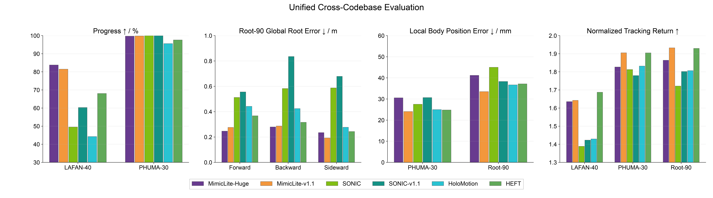

[中文版](README_cn.md) | [English](README.md)

# MimicLite

MimicLite is an efficient, general humanoid motion-tracking system for training deployable PPO and PPO-ROA policies with competitive tracking quality. Under a matched MuJoCo evaluation, MimicLite improves global root tracking over SONIC while achieving comparable local tracking accuracy. The same policy family supports low-latency Pico-driven teleoperation and highly dynamic motion tracking on a physical Unitree G1.

The technical report is available at [`mimic-lite.pdf`](mimic-lite.pdf).

## Project Repositories

This repository is the project landing page. Its submodules pin the multi-robot
MimicLite implementation and the public main training framework. Training, evaluation, dataset conversion, and deployment instructions are maintained in their respective repositories:

| Component | Repository | Contents |
| --- | --- | --- |
| MimicLite | [`EGalahad/mimic-lite`](https://github.com/EGalahad/mimic-lite/tree/feat/multi-robot-support) | Training, evaluation, policy export, task configs, and learning code. |
| Training framework | [`Agent-3154/active-adaptation`](https://github.com/Agent-3154/active-adaptation) | Simulation backends, distributed launchers, environments, and shared infrastructure. |
| Motion data toolkit | [`EGalahad/any4hdmi`](https://github.com/EGalahad/any4hdmi) | Motion conversion, validation, visualization, and dataset tooling. |
| Deployment runtime | [`EGalahad/sim2real`](https://github.com/EGalahad/sim2real) | ONNX inference, MuJoCo sim2sim, Pico teleoperation, and Unitree G1 deployment. |

## Released Checkpoints

Released checkpoints below are Finetune-stage ROA student policies. G1 uses
MimicLite v1.1; the other rows are robot-matched student releases.

| Robot | Checkpoint |
| --- | --- |
| G1 | [Google drive link](https://drive.google.com/drive/folders/1lrPyiiy7anyG3P4wHNIQQQlydboLPd9e) |
| H2 | [Google drive link](https://drive.google.com/open?id=1eHO5DXvlHnfT_6QD0Q2NI1cK0xv6NGhA) |
| A3 | [Google drive link](https://drive.google.com/open?id=10Lthw5p7hrLtIBB47xXPm3vHToAH2-1F) |
| RP1, 28 DoF | [Google drive link](https://drive.google.com/open?id=10nzo4O9ZFJTLf0283RKns_Xmm4YxhjL1) |
| RP1, 24 DoF | [Google drive link](https://drive.google.com/open?id=1QSMEzhPz_YJ29LB0LP6VC3V9lR73sDwP) |

See [robot profiles and checkpoint details](https://github.com/EGalahad/mimic-lite/blob/feat/multi-robot-support/docs/checkpoints.md)
for motion datasets, model revisions, and bundle contents. The A3 release uses a
LAFAN / 100style / seed mixture with 8 × 4,096 environments. G1 v1.1 and RP1
use 8 × 8,192 environments. These policies use 4,000 / 1,000 / 2,000
Train / Adapt / Finetune updates. H2 releases
retain their original training configurations.

The comparison plot below reports **G1 evaluation only**.

For a fair comparison, we report the motion-lookahead latency required by each
policy, defined by its furthest required future-reference frame. All values use
the shared 50 Hz reference-motion contract.

| Policy | MimicLite-PPO | MimicLite-ROA | BFM-Zero | SONIC | SONIC-v1.1 | SONIC low-latency | HoloMotion | TeleopIT | Humanoid-GPT | HEFT | TWIST2 |
| --- | ---: | ---: | ---: | ---: | ---: | ---: | ---: | ---: | ---: | ---: | ---: |
| Motion-lookahead latency | 0.08 s | 0.08 s | 0.12 s | 0.90 s | 0.90 s | 0.18 s | 0.20 s | 0.00 s | 0.02 s | 0.12 s | 0.00 s |

## Training Data

Released training datasets are collected in the [`any4hdmi` Hugging Face collection](https://huggingface.co/collections/elijahgalahad/any4hdmi). The [`BONES-SEED` dataset](https://huggingface.co/datasets/bones-studio/seed) is the exception: to respect its license and redistribution terms, users obtain it from the original source, while [`EGalahad/any4hdmi`](https://github.com/EGalahad/any4hdmi) provides only the conversion scripts and processing tools.

## Deployment Support

The [`sim2real`](https://github.com/EGalahad/sim2real) runtime provides a modular observation interface that separates policy-specific input construction from the shared deployment runtime. Integrating a policy requires only an observation class and a YAML specification; the inference, simulator, and robot interfaces remain unchanged. This common path supports integrated MuJoCo evaluation and real-robot execution for MimicLite, HEFT, TeleopIT, Humanoid-GPT, BFM-Zero, SONIC, and TWIST2. Policy inference is decoupled from robot I/O through interchangeable MuJoCo and physical Unitree G1 backends.

## License

This integration repository is released under GPL-3.0-or-later. Component repositories retain their own histories and license files; verify dataset and component licenses before redistribution.
